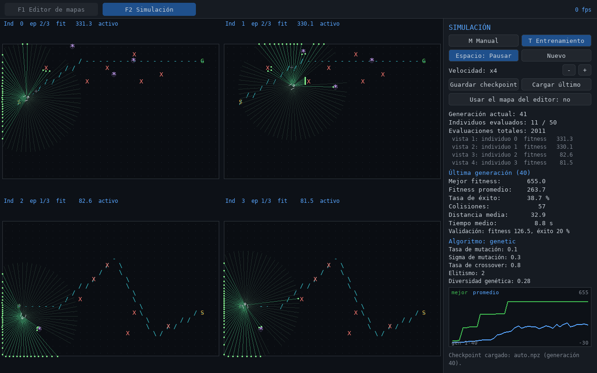
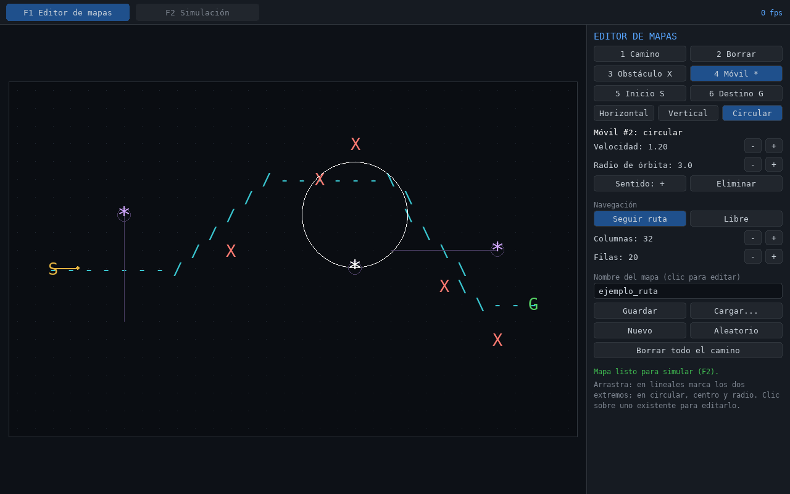
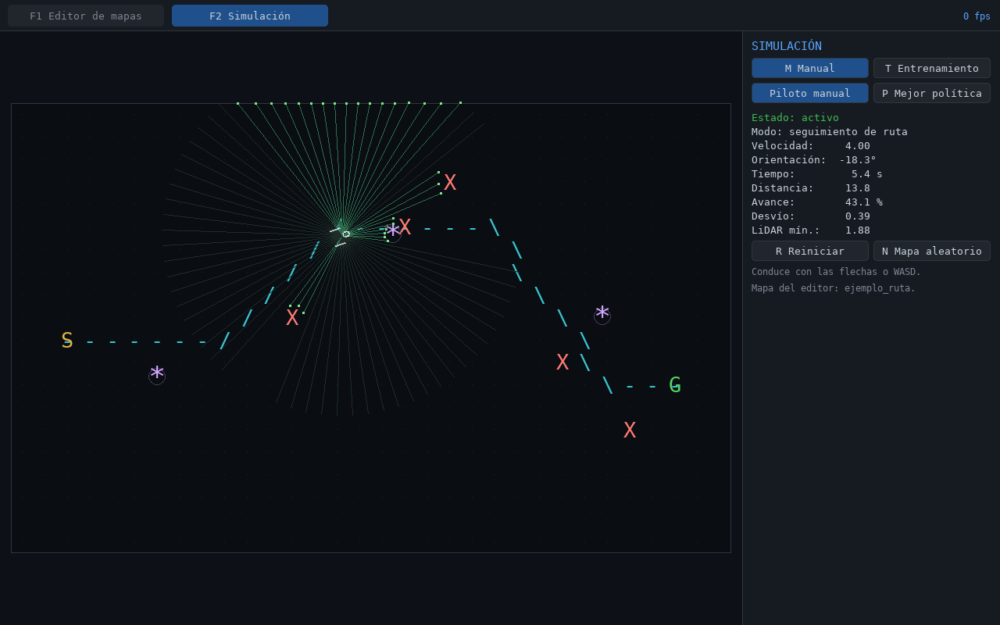

# Simulador LiDAR con algoritmos evolutivos

Simulador 2D de un vehículo autónomo que detecta obstáculos con un sensor LiDAR
de 72 rayos y **aprende a navegar mediante algoritmos evolutivos**. Incluye un
editor visual de mapas en ASCII y permite ver varios individuos de una misma
generación entrenando a la vez.



*Generación 41 de un entrenamiento con algoritmo genético: cuatro individuos,
cada uno en su propio escenario, con su LiDAR, su fitness parcial y la evolución
del mejor fitness y del promedio.*

## Qué hace

- **Editor de mapas** sobre una grilla: caminos dibujados con el mouse,
  obstáculos estáticos (`X`), obstáculos dinámicos (`*`) con trayectoria
  horizontal, vertical o circular, inicio (`S`) con orientación y destino (`G`).
  Los mapas se guardan en JSON.
- **Simulación continua**: vehículo con posición, orientación, velocidad,
  dirección, aceleración y frenado; colisiones; LiDAR por raycasting geométrico.
- **Dos modos de navegación** con un mismo simulador: seguir la ruta dibujada
  (pudiendo apartarse para esquivar y volver) o navegar libremente al destino.
- **Entrenamiento evolutivo**: un algoritmo genético evoluciona los pesos de una
  red neuronal que conduce el vehículo. Cada individuo se evalúa en varios
  escenarios aleatorios, iguales para toda la generación y reproducibles por semilla.
- **Con o sin ventana**: se entrena viendo `visible_agents` individuos a la vez,
  o desde la terminal sin abrir nada. Hay checkpoints y un registro por generación.
- **Arquitectura modular**: el simulador no conoce ningún algoritmo de
  aprendizaje. El algoritmo genético es un plugin; PSO, ACO o ABC pueden
  agregarse después sin tocar la física ni el vehículo.

## Requisitos

- Python 3.10 o superior.
- [Pygame](https://www.pygame.org/) 2.5+ y [NumPy](https://numpy.org/) 1.21+
  (`requirements.txt`); `pytest` para las pruebas (`requirements-dev.txt`).

Probado con Python 3.10, Pygame 2.6 y NumPy 2.2 en Linux.

## Instalación

```bash
git clone https://github.com/fblazco/lidar-sim.git
cd lidar-sim
python3 -m venv .venv
.venv/bin/pip install -r requirements-dev.txt
```

En Ubuntu sin el paquete `python3-venv`, el segundo comando falla por falta de
`ensurepip`. Alternativa sin permisos de administrador (ajusta `3.10` a tu
versión de Python):

```bash
python3 -m venv --without-pip .venv
python3 -m pip install --target .venv/lib/python3.10/site-packages -r requirements-dev.txt
```

## Inicio rápido

```bash
.venv/bin/python main.py
```

1. Se abre el **editor** (F1). Pulsa "Cargar..." y elige `ejemplo_ruta`, o
   dibuja tu propio mapa.
2. Pasa a **simulación** con F2 y conduce con las flechas o WASD.
3. Pulsa `T` para la vista de **entrenamiento** y `Espacio` para empezar.
   Con `+` aceleras a los agentes visibles.
4. Cuando termine alguna generación, vuelve a `M` y pulsa `P` para ver conducir
   a la mejor política.

## La aplicación

### Editor de mapas (F1)



| Símbolo | Elemento | Herramienta |
|---|---|---|
| `-` `\|` `/` `\` | Camino | `1` arrastrar; el orden del trazo es el orden de la ruta |
| `X` | Obstáculo estático | `3` clic o arrastre |
| `*` | Obstáculo dinámico | `4` arrastrar: extremos (lineales) o centro y radio (circular) |
| `S` | Inicio del vehículo | `5` clic para ubicar, arrastrar para orientar |
| `G` | Destino | `6` clic |
| | Borrar | `2` clic o arrastre |

Al seleccionar un obstáculo dinámico se editan su velocidad, pausas, extremos,
radio y sentido. El panel indica si el mapa está listo para simular o qué falta.

### Simulación (F2)



- **Manual (`M`)**: flechas o WASD. `R` reinicia, `N` genera un mapa aleatorio,
  `P` alterna entre el piloto manual y la mejor política entrenada. El vehículo
  se dibuja como `o` sobre `| |` y su LiDAR está siempre visible.
- **Entrenamiento (`T`)**: `Espacio` inicia o pausa, `+` y `-` cambian la
  velocidad. El panel muestra generación, individuos evaluados, mejor fitness,
  promedio, tasa de éxito, colisiones, distancia, tiempo, validación, las
  estadísticas propias del algoritmo y el gráfico de evolución.

Guía completa: [docs/GUIDE.md](docs/GUIDE.md).

## Entrenar sin ventana

```bash
.venv/bin/python main.py train --generations 50 --name experimento1
```

Escribe el checkpoint en `models/experimento1.npz` y una línea JSON por
generación (con las semillas de los escenarios) en `logs/experimento1.jsonl`.
Para continuar un entrenamiento:

```bash
.venv/bin/python main.py train --generations 50 --resume models/experimento1.npz --name experimento1
```

## Configuración

Todos los parámetros ajustables están en
[config/default.json](config/default.json): población, agentes visibles,
semilla, escenarios, pesos del fitness, vehículo, LiDAR, red neuronal,
generador de mapas y operadores genéticos. Para cambiarlos sin editar ese
archivo, crea un JSON solo con lo que quieras modificar:

```json
{"training": {"population_size": 80, "visible_agents": 6}, "lidar": {"max_range": 10.0}}
```

```bash
.venv/bin/python main.py --config mi_config.json
```

## Estructura del proyecto

```
main.py              entrada: ventana, o `train` sin ventana
bootstrap.py         ensambla el sistema a partir de la configuración
config/              parámetros (default.json)
simulation/          mundo, vehículo, obstáculos, colisiones, navegación
sensors/             LiDAR
control/             contrato Controller, control manual, red MLP, ObservationBuilder
optimization/        contrato LearningStrategy, fitness, evaluación, entrenamiento, checkpoints
optimization/genetic/   algoritmo genético (plugin)
editor/              modelo del editor, guardado y carga, generador de mapas
rendering/           dibujo ASCII
ui/                  ventana, vistas y panel de entrenamiento
maps/                mapas guardados (incluye dos ejemplos)
models/  logs/       checkpoints y registros de entrenamiento (no se versionan)
tests/               pruebas automáticas
docs/                especificación, arquitectura, estado y solicitudes
```

La regla central: **el simulador, el vehículo, el sensor y el editor no
dependen de ningún algoritmo de aprendizaje**. Si se borra
`optimization/genetic/`, todo lo demás sigue funcionando, y una prueba lo
comprueba. Detalle en [docs/architecture/OVERVIEW.md](docs/architecture/OVERVIEW.md).

## Pruebas

```bash
.venv/bin/python -m pytest
```

Cubren movimiento, colisiones, LiDAR, trayectorias de obstáculos, mapas,
reproducibilidad por semilla, operadores genéticos, fitness, evolución de
generaciones, la aplicación (sin ventana real), la independencia entre el
simulador y el algoritmo, y los enlaces de esta documentación.

## Estado

Primera versión funcional: cumple los doce criterios de aceptación de la
[especificación](docs/specification/PROJECT_SPEC.md). Qué está verificado, qué
es parcial y qué falta: [docs/status/PROJECT_STATUS.md](docs/status/PROJECT_STATUS.md).
Lo que sigue: [docs/status/ROADMAP.md](docs/status/ROADMAP.md).

## Documentación

| Documento | Contenido |
|---|---|
| [docs/README.md](docs/README.md) | Índice y forma de trabajo |
| [docs/GUIDE.md](docs/GUIDE.md) | Uso de la aplicación y de la configuración |
| [docs/specification/](docs/specification/) | Requisitos del proyecto (editables) |
| [docs/architecture/](docs/architecture/) | Organización, contratos y decisiones |
| [docs/status/](docs/status/) | Estado, roadmap, backlog y problemas conocidos |
| [docs/CHANGELOG.md](docs/CHANGELOG.md) | Historial de cambios |

## Cómo pedir cambios

Los requisitos se cambian en Markdown, sin tocar el código: editando un
documento de `docs/specification/` o creando una solicitud en
`docs/requests/open/` a partir de la plantilla. El procedimiento está en
[docs/requests/README.md](docs/requests/README.md).
