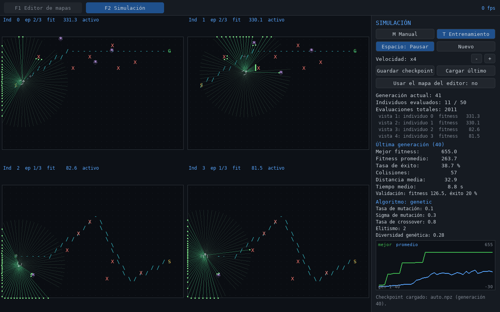

# Guía de uso

## Abrir la aplicación

```bash
.venv/bin/python main.py
```

Una sola ventana con dos modos: **F1 Editor de mapas** y **F2 Simulación**.

## Modo 1: Editor


| Herramienta | Tecla | Uso |
|---|---|---|
| Camino | 1 | Arrastrar. El orden en que se dibuja es el orden de la ruta. |
| Borrar | 2 | Clic o arrastre sobre la celda. |
| Obstáculo X | 3 | Clic o arrastre. |
| Móvil * | 4 | Elegir Horizontal, Vertical o Circular y arrastrar: en los lineales, de un extremo al otro (empieza en el primero); en el circular, del centro a la posición inicial. Clic sin arrastrar usa un recorrido por defecto. Clic sobre uno existente lo selecciona para editar velocidad, pausa, extremos, radio y sentido. `Supr` lo elimina. |
| Inicio S | 5 | Clic para ubicar el vehículo; arrastrar para orientarlo. |
| Destino G | 6 | Clic. |

El panel permite además elegir el modo de navegación (seguir ruta o libre),
cambiar el tamaño de la grilla, poner nombre, guardar y cargar (`maps/*.json`),
generar un mapa aleatorio y vaciar el mapa. Abajo se indica si el mapa está
listo para simular o qué le falta.

El repositorio trae dos mapas de ejemplo en `maps/`: `ejemplo_ruta` (seguimiento
de ruta, con los tres tipos de obstáculo móvil) y `ejemplo_libre` (navegación
libre). Se abren con "Cargar...".

Símbolos: `|` `-` `/` `\` caminos, `X` obstáculo estático, `*` obstáculo
dinámico, `S` inicio, `G` destino, `o` sobre `| |` el vehículo.

## Modo 2: Simulación


**Manual (M).** Se conduce el mapa del editor con flechas o WASD. Si el mapa
está incompleto se usa uno aleatorio. `R` reinicia, `N` genera otro mapa, `P`
alterna entre el piloto manual y la mejor política entrenada.



**Entrenamiento (T).** `Espacio` inicia o pausa. Se muestran `visible_agents`
individuos de la generación en curso, cada uno en su propio escenario; el resto
se evalúa sin dibujarse. `+` y `-` cambian la velocidad de los visibles. El
panel muestra las estadísticas y el gráfico de fitness. "Guardar checkpoint"
escribe en `models/`; "Cargar último" retoma el más reciente. "Usar el mapa del
editor" suma ese mapa a los escenarios de cada individuo (se aplica al pulsar
"Nuevo"). El entrenamiento solo avanza mientras esta vista está abierta.

Cada vista muestra el número de individuo, el episodio en curso (uno por
escenario), su fitness parcial y su estado. El vehículo se ve blanco mientras
está activo, rojo si chocó, verde si llegó y gris si se le acabó el tiempo.

## Entrenar sin ventana

```bash
.venv/bin/python main.py train --generations 50 --name experimento1
.venv/bin/python main.py train --generations 50 --resume models/experimento1.npz --name experimento1
```

Deja el checkpoint en `models/<nombre>.npz` y una línea JSON por generación
(con las semillas de los escenarios) en `logs/<nombre>.jsonl`.

## Configuración

Todos los parámetros están en `config/default.json`. Para cambiarlos sin
tocarlo, crear un JSON solo con las claves a modificar y pasarlo con `--config`:

```json
{"training": {"population_size": 80, "visible_agents": 6}, "lidar": {"max_range": 10.0}}
```

| Sección | Qué controla |
|---|---|
| `window` | tamaño de ventana y cuadros por segundo |
| `map` | tamaño de grilla por defecto |
| `simulation` | paso de tiempo, límite del episodio, radio de llegada |
| `vehicle` | radio, velocidades, aceleración, ángulo de dirección |
| `lidar` | rayos, campo de visión, alcance |
| `observation`, `policy` | entradas de la red y capas ocultas |
| `training` | estrategia, `population_size`, `visible_agents`, semilla, escenarios, checkpoints |
| `fitness` | pesos de la función de fitness |
| `generator` | mapas aleatorios |
| `genetic` | elitismo, torneo, crossover, mutación |

## Pruebas

```bash
.venv/bin/python -m pytest
```
