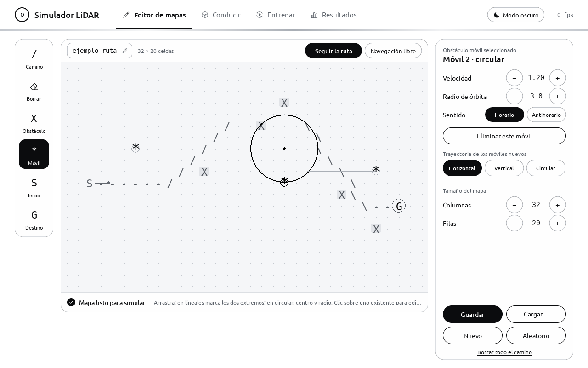
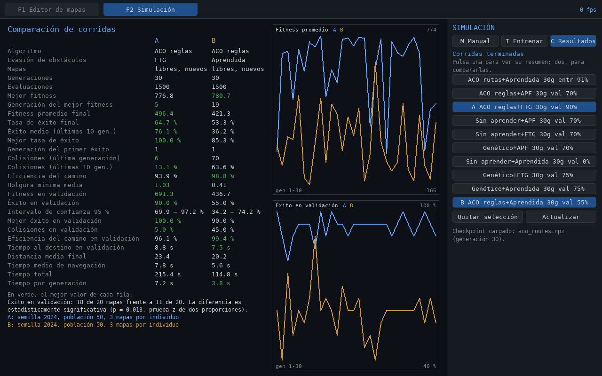

# Guía de uso

## Abrir la aplicación

```bash
.venv/bin/python main.py
```

Una sola ventana con dos modos: **F1 Editor de mapas** y **F2 Simulación**.

## Modo 1: Editor



| Herramienta | Tecla | Uso |
|---|---|---|
| Camino | 1 | Arrastrar. El orden en que se dibuja es el orden de la ruta. |
| Borrar | 2 | Clic o arrastre sobre la celda. |
| Obstáculo X | 3 | Clic o arrastre. |
| Móvil * | 4 | Elegir Horizontal, Vertical o Circular y arrastrar: en los lineales, de un extremo al otro (empieza en el primero); en el circular, del centro a la posición inicial. Clic sin arrastrar usa un recorrido por defecto. Clic sobre uno existente lo selecciona para editar velocidad, pausa, extremos, radio y sentido. `Supr` lo elimina. |
| Inicio S | 5 | Clic para ubicar el vehículo; arrastrar para orientarlo. |
| Destino G | 6 | Clic. |

El panel permite además elegir el modo de navegación (seguir ruta o libre),
cambiar el tamaño de la grilla, poner nombre, guardar y cargar (`maps/*.json`),
generar un mapa aleatorio y vaciar el mapa. Abajo se indica si el mapa está
listo para simular o qué le falta.

El repositorio trae dos mapas de ejemplo en `maps/`: `ejemplo_ruta` (seguimiento
de ruta, con los tres tipos de obstáculo móvil) y `ejemplo_libre` (navegación
libre). Se abren con "Cargar...".

Símbolos: `|` `-` `/` `\` caminos, `X` obstáculo estático, `*` obstáculo
dinámico, `S` inicio, `G` destino, `o` sobre `| |` el vehículo.

## Modo 2: Simulación

Tiene tres vistas: **M** Manual, **T** Entrenar y **C** Resultados.

### Manual (M)


Se conduce el mapa del editor con flechas o WASD. Si el mapa está incompleto se
usa uno aleatorio. `R` reinicia, `N` genera otro mapa y `P` alterna entre el
piloto manual y **lo aprendido** por el último entrenamiento.

Cuando el episodio termina (el vehículo llega, choca o se queda sin tiempo)
aparece su resumen: resultado, tiempo, distancia, velocidad media, avance,
desvío medio, suavidad y el fitness que habría obtenido.

Con la colonia de rutas, "lo aprendido" solo existe para los mapas con que
entrenó: si el mapa actual no es uno de ellos, se muestra el primero de
entrenamiento.

### Entrenar (T)


| Control | Tecla | Qué hace |
|---|---|---|
| Navegación `<` `>` | | Quién decide hacia dónde ir: el algoritmo que se entrena. |
| Evasión `<` `>` | | Quién esquiva los obstáculos: lo aprendido, FTG o APF. |
| Mapas `<` `>` | | Tipo de mapas aleatorios: libres, con ruta dibujada o mixtos. |
| Iniciar / Pausar | Espacio | Arranca o detiene el entrenamiento. |
| Nuevo | | Descarta el entrenamiento actual y prepara otro con la selección de los tres controles anteriores. |
| Finalizar | F | Da por terminada la corrida, guarda su registro y muestra sus estadísticas. |
| Velocidad `-` `+` | `-` `+` | Velocidad de los agentes visibles (x1 a x32). |
| Límite `-` `+` | | Generaciones tras las que la corrida finaliza sola. "Sin límite" entrena hasta pulsar Finalizar. |
| Guardar checkpoint / Cargar último | | Guarda en `models/` o retoma el más reciente. |
| Usar el mapa del editor | | Suma ese mapa a los de cada individuo (al pulsar Nuevo). |

Se muestran `visible_agents` individuos de la generación en curso, cada uno en
su propio escenario; el resto se evalúa sin dibujarse. Cada vista indica el
número de individuo, el episodio en curso (uno por escenario), su fitness
parcial y su estado. El vehículo se ve blanco mientras está activo, rojo si
chocó, verde si llegó y gris si se le acabó el tiempo. El entrenamiento solo
avanza mientras esta vista está abierta.

Cada generación se entrena con **mapas aleatorios nuevos**, iguales para todos
sus individuos, y el mejor se prueba en un conjunto fijo de mapas de validación
que nunca interviene en la selección. Por eso las curvas de entrenamiento suben
y bajan: el mismo individuo puntúa distinto en mapas distintos. La referencia
estable es la validación.

**Navegación**

| Opción | Qué aprende | Validación en mapas no vistos |
|---|---|---|
| Genético | Los pesos de una red neuronal que conduce | Sí |
| ACO reglas | Una tabla "situación del LiDAR y del objetivo → maniobra", elegida con feromonas | Sí |
| ACO rutas | Una ruta celda a celda sobre cada mapa de entrenamiento (sus mapas no cambian) | No aplica |
| Sin aprender | Nada: apunta al objetivo. Es la línea de base | Sí |

**Evasión de obstáculos**

| Opción | Cómo esquiva |
|---|---|
| Aprendida | Sin capa adicional: la navegación aprende a esquivar con el LiDAR |
| FTG | Follow the Gap: encara el hueco más ancho entre los obstáculos |
| APF | Campos potenciales: el destino atrae y los obstáculos repelen |

Cualquier navegación se combina con cualquier evasión. "Sin aprender" con FTG o
APF mide esos métodos por sí solos; "Sin aprender" con "Aprendida" no esquiva
nada y muestra qué tan difíciles son los mapas.


Con ACO rutas se ven las feromonas de cada mapa (manchas anaranjadas, más
intensas donde se concentra el rastro) y, en azul, la ruta que sigue cada hormiga.
Para que la colonia aprenda un mapa propio, dibújalo en el editor y activa
"Usar el mapa del editor" antes de pulsar Nuevo.

### Resultados (C)



Cada corrida finalizada queda en la lista, de la más reciente a la más antigua.

- **Una seleccionada:** su resumen y sus curvas de fitness y de éxito.
- **Dos seleccionadas (A y B):** la misma tabla lado a lado, con el mejor valor
  de cada fila en verde, las curvas de ambas superpuestas y una frase que dice
  si la diferencia de éxito en validación es estadísticamente significativa.
  Si no usaron los mismos mapas, se avisa.

Al finalizar una corrida se abre esta vista con ella como A y, si existe, la
última corrida de otra combinación como B.

Qué mide cada grupo de filas:

| Para comparar | Filas |
|---|---|
| Evasión de obstáculos | Colisiones (entrenamiento y validación), holgura mínima media |
| Camino más corto | Eficiencia del camino (camino más corto del mapa / distancia recorrida), tiempo al destino |
| Aprendizaje | Mejor fitness, generación del primer éxito, éxito medio de las últimas 10 generaciones |
| Generalización | Éxito en validación, su intervalo de confianza del 95 % y el mejor éxito en validación |
| Costo | Tiempo por generación |

## Línea de comandos

```bash
.venv/bin/python main.py train --strategy genetic --avoidance learned --generations 30
.venv/bin/python main.py train --strategy genetic --avoidance ftg --generations 30
.venv/bin/python main.py train --strategy reactive --avoidance apf --generations 30
.venv/bin/python main.py runs
.venv/bin/python main.py compare genetic genetic_ftg
```

- `train` entrena sin ventana. `--strategy` elige la navegación (`genetic`,
  `aco_rules`, `aco_routes`, `reactive`), `--avoidance` la evasión (`learned`,
  `ftg`, `apf`) y `--maps` el tipo de mapas (`free`, `route`, `mixed`).
  `--name` cambia el nombre de la corrida (por defecto, navegación y evasión,
  como `genetic_ftg`); `--resume models/<nombre>.npz` continúa una.
  Al terminar imprime el resumen y deja el checkpoint en `models/<nombre>.npz`,
  una línea JSON por generación en `logs/<nombre>.jsonl` y el registro de la
  corrida en `logs/runs/<nombre>.json`.
- `runs` lista las corridas terminadas (también las hechas desde la ventana)
  con su éxito en validación, intervalo de confianza, colisiones y eficiencia.
- `compare A B` imprime la tabla comparativa (un asterisco marca el mejor valor)
  y si la diferencia en validación es significativa.

## Configuración

Todos los parámetros están en `config/default.json`. Para cambiarlos sin
tocarlo, crear un JSON solo con las claves a modificar y pasarlo con `--config`:

```json
{"training": {"population_size": 80, "visible_agents": 6}, "lidar": {"max_range": 10.0}}
```

| Sección | Qué controla |
|---|---|
| `window` | tamaño de ventana y cuadros por segundo |
| `map` | tamaño de grilla por defecto |
| `simulation` | paso de tiempo, límite del episodio, radio de llegada |
| `vehicle` | radio, velocidades, aceleración, ángulo de dirección |
| `lidar` | rayos, campo de visión, alcance |
| `observation`, `policy` | entradas de la red y capas ocultas |
| `training` | navegación (`strategy`), evasión (`avoidance`), `population_size`, `visible_agents`, semilla, escenarios, `resample_scenarios_every`, `max_iterations`, checkpoints |
| `fitness` | pesos de la función de fitness, incluida la eficiencia del camino |
| `generator` | mapas aleatorios: `navigation_mode` (`free`, `route`, `mixed`), obstáculos, paredes |
| `avoidance` | parámetros de FTG y de APF |
| `reactive` | velocidad de crucero de la navegación de referencia |
| `genetic` | elitismo, torneo, crossover, mutación |
| `rule_policy` | distancias "cerca" y "medio" de la tabla de reglas |
| `aco_rules` | alfa, beta, evaporación, hormigas que depositan, cotas de feromona |
| `aco_routes` | lo mismo, más atracción al camino dibujado, holgura junto a obstáculos y parámetros del seguidor de rutas |

`population_size` es también el número de hormigas de las colonias.

## Pruebas

```bash
.venv/bin/python -m pytest
```
