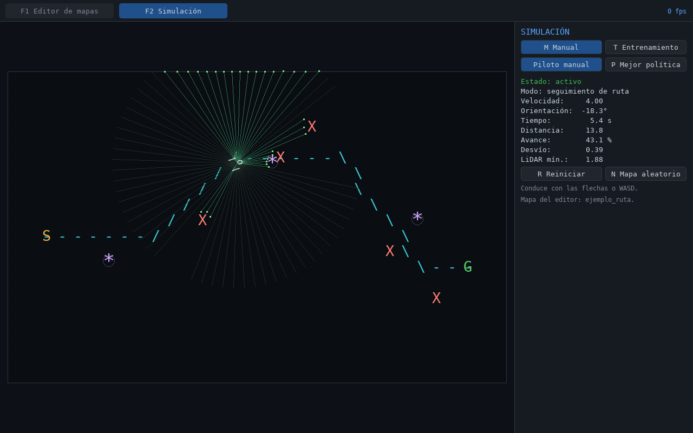
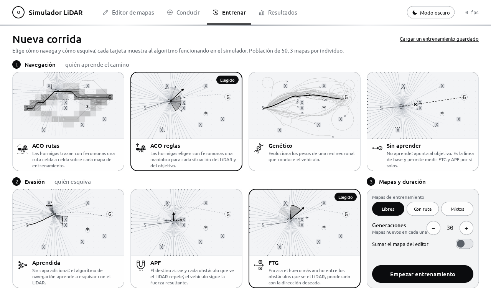
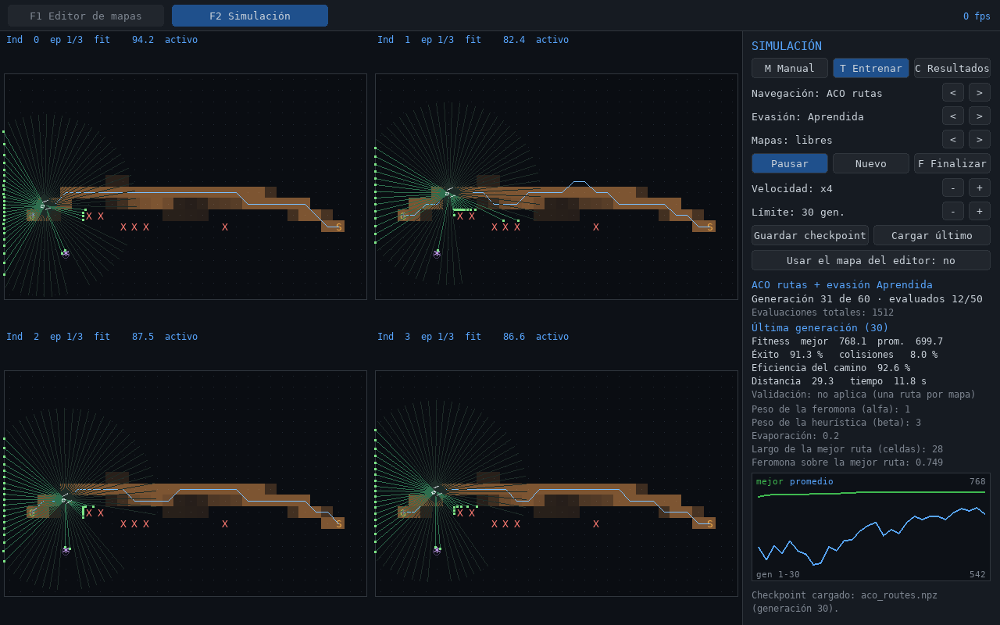

# Guía de uso

## Abrir la aplicación

```bash
.venv/bin/python main.py
```

Una sola ventana. La barra superior tiene cuatro secciones: **Editor de mapas**,
**Conducir**, **Entrenar** y **Resultados**. A la derecha, un botón recorre tres
temas con la misma disposición: **claro**, **oscuro** y **Aula Ubuntu**, de papel
cálido, tinta ciruela y acentos naranjas. El tema con que se abre se fija en
`window.theme` (`light`, `dark` o `ubuntu`); el elegido con el botón no se guarda.

Teclado: `F1` abre el editor y `F2` la simulación; dentro de ella, `M` es
Conducir, `T` Entrenar y `C` Resultados.

## Editor de mapas


Las herramientas están en la columna de la izquierda; cada una muestra el
símbolo que coloca en el mapa.

| Herramienta | Tecla | Uso |
|---|---|---|
| Camino `/` | 1 | Arrastrar. El orden en que se dibuja es el orden de la ruta. |
| Borrar | 2 | Clic o arrastre sobre la celda. |
| Obstáculo `X` | 3 | Clic o arrastre. |
| Móvil `*` | 4 | Elegir Horizontal, Vertical o Circular y arrastrar: en los lineales, de un extremo al otro (empieza en el primero); en el circular, del centro a la posición inicial. Clic sin arrastrar usa un recorrido por defecto. Clic sobre uno existente lo selecciona para editar velocidad, pausa, extremos, radio y sentido. `Supr` lo elimina. |
| Inicio `S` | 5 | Clic para ubicar el vehículo; arrastrar para orientarlo. |
| Destino `G` | 6 | Clic. |

Sobre el mapa están su nombre (clic para escribirlo) y el modo de navegación:
seguir la ruta o navegación libre. Debajo se indica si el mapa está listo para
simular o qué le falta. El panel de la derecha muestra la herramienta elegida o
las propiedades del obstáculo móvil seleccionado, el tamaño de la grilla y los
botones Guardar, Cargar… (lista de `maps/*.json`), Nuevo y Aleatorio.

El repositorio trae dos mapas de ejemplo en `maps/`: `ejemplo_ruta` (seguimiento
de ruta, con los tres tipos de obstáculo móvil) y `ejemplo_libre` (navegación
libre). Se abren con "Cargar…".

Símbolos: `|` `-` `/` `\` caminos, `X` obstáculo estático, `*` obstáculo
dinámico, `S` inicio, `G` destino, `o` sobre `| |` el vehículo. No hay colores:
cada elemento se distingue por su símbolo y su brillo.

## Conducir



Se conduce el mapa del editor con flechas o WASD. Si el mapa está incompleto se
usa uno aleatorio. Arriba se elige el piloto: **Manual** o **Lo aprendido** por
el último entrenamiento (`P` alterna). `R` reinicia y `N` genera otro mapa. Una
línea marca el camino recorrido.

El panel muestra tiempo, distancia, velocidad y avance del episodio. Cuando
termina (el vehículo llega, choca o se queda sin tiempo) aparece su resumen:
resultado, tiempo, distancia, velocidad media, avance, desvío medio, suavidad y
el fitness que habría obtenido.

Con la colonia de rutas, "lo aprendido" solo existe para los mapas con que
entrenó: si el mapa actual no es uno de ellos, se muestra el primero de
entrenamiento.

## Entrenar

### Preparar la corrida



Antes de empezar se elige con tarjetas. Cada tarjeta lleva el ícono del
algoritmo, una frase que dice qué hace y una **escena**: un cuadro del simulador
con el algoritmo funcionando.

| Fila | Qué se elige |
|---|---|
| 1 · Navegación | Quién decide hacia dónde ir: el algoritmo que se entrena. |
| 2 · Evasión | Quién esquiva los obstáculos: lo aprendido, FTG o APF. |
| 3 · Mapas y duración | Tipo de mapas aleatorios (libres, con ruta o mixtos), generaciones tras las que la corrida finaliza sola (`∞` entrena hasta pulsar Finalizar) y si se suma el mapa del editor a los de cada individuo. |

"Empezar entrenamiento" (o `Espacio`) inicia la corrida. "Cargar un
entrenamiento guardado" retoma el checkpoint más reciente de `models/`.

Qué muestra cada escena:

| Tarjeta | En la escena |
|---|---|
| Genético | Los recorridos de toda una generación sobre el mismo mapa; el más grueso es el mejor y las cruces marcan choques. |
| ACO reglas | Los tres sectores del LiDAR (más marcado, obstáculo más cerca) y el abanico de maniobras: flecha más gruesa, más feromona; la más clara es la elegida. |
| ACO rutas | La feromona de cada celda y la mejor ruta trazada. |
| Sin aprender | La línea recta al destino y la cruz donde choca. |
| Aprendida | El recorrido de un modelo entrenado; los rayos del LiDAR cercanos a un obstáculo van resaltados. |
| FTG | Los huecos libres, el elegido resaltado, la dirección deseada (línea cortada) y el rumbo final (flecha gruesa). |
| APF | El círculo de influencia, los empujes de cada punto del obstáculo, la atracción al destino (línea cortada) y la fuerza resultante (flecha gruesa). |

### Corrida en curso


| Control | Tecla | Qué hace |
|---|---|---|
| Iniciar / Pausar / Continuar | Espacio | Arranca o detiene el entrenamiento. |
| Finalizar | F | Da por terminada la corrida, guarda su registro y muestra sus estadísticas. |
| Velocidad `−` `+` | `-` `+` | Velocidad de los agentes visibles (×1 a ×32). |
| Botones 1, 2, 3… o clic en una miniatura | | Eligen qué agente se ve en grande. |
| Guardar checkpoint | | Guarda la corrida en `models/`. |
| Nueva corrida | | Descarta la corrida actual y vuelve a las tarjetas. |

Se muestran `visible_agents` individuos de la generación en curso: uno en grande
y los demás en miniatura; el resto se evalúa sin dibujarse. Sobre el agente
grande se lee el número de individuo, el mapa en curso (uno por escenario), su
fitness parcial y su estado; una línea marca su camino. El vehículo se ve más
apagado cuando chocó o se quedó sin tiempo. El entrenamiento solo avanza
mientras esta vista está abierta.

A la derecha están la generación en curso, el avance y las cifras propias del
algoritmo. Abajo, tres tarjetas: la última generación (fitness, éxito,
colisiones, eficiencia del camino, tiempo), la validación y la evolución del
fitness (mejor en línea sólida, promedio en línea cortada).

Cada generación se entrena con **mapas aleatorios nuevos**, iguales para todos
sus individuos, y el mejor se prueba en un conjunto fijo de mapas de validación
que nunca interviene en la selección. Por eso las curvas de entrenamiento suben
y bajan: el mismo individuo puntúa distinto en mapas distintos. La referencia
estable es la validación.

**Navegación**

| Opción | Qué aprende | Validación en mapas no vistos |
|---|---|---|
| Genético | Los pesos de una red neuronal que conduce | Sí |
| ACO reglas | Una tabla "situación del LiDAR y del objetivo → maniobra", elegida con feromonas | Sí |
| ACO rutas | Una ruta celda a celda sobre cada mapa de entrenamiento (sus mapas no cambian) | No aplica |
| Sin aprender | Nada: apunta al objetivo. Es la línea de base | Sí |

**Evasión de obstáculos**

| Opción | Cómo esquiva |
|---|---|
| Aprendida | Sin capa adicional: la navegación aprende a esquivar con el LiDAR |
| FTG | Follow the Gap: encara el hueco más ancho entre los obstáculos |
| APF | Campos potenciales: el destino atrae y los obstáculos repelen |

Cualquier navegación se combina con cualquier evasión. "Sin aprender" con FTG o
APF mide esos métodos por sí solos; "Sin aprender" con "Aprendida" no esquiva
nada y muestra qué tan difíciles son los mapas.



Con ACO rutas se ven las feromonas de cada mapa (celdas sombreadas, más
intensas donde se concentra el rastro) y la ruta que sigue cada hormiga. Para
que la colonia aprenda un mapa propio, dibújalo en el editor y activa "Sumar el
mapa del editor" antes de empezar.

## Resultados


Cada corrida finalizada queda en la lista, de la más reciente a la más antigua,
con los íconos de su navegación y de su evasión.

- **Una seleccionada:** su resumen completo y sus curvas de fitness y de éxito.
- **Dos seleccionadas (A y B):** una frase que dice si la diferencia de éxito en
  validación es estadísticamente significativa, barras para los porcentajes más
  importantes (A maciza, B con contorno), recuadros con el resto de lo esencial
  y las curvas de ambas superpuestas (A en línea sólida, B en línea cortada). El
  mejor valor de cada fila va resaltado. "Todas las métricas" cambia a la tabla
  completa. Si no usaron los mismos mapas, se avisa.

Al finalizar una corrida se abre esta vista con ella como A y, si existe, la
última corrida de otra combinación como B.

Qué mide cada grupo de filas:

| Para comparar | Filas |
|---|---|
| Evasión de obstáculos | Colisiones (entrenamiento y validación), holgura mínima media |
| Camino más corto | Eficiencia del camino (camino más corto del mapa / distancia recorrida), tiempo al destino |
| Aprendizaje | Mejor fitness, generación del primer éxito, éxito medio de las últimas 10 generaciones |
| Generalización | Éxito en validación, su intervalo de confianza del 95 % y el mejor éxito en validación |
| Costo | Tiempo por generación |

## Línea de comandos

```bash
.venv/bin/python main.py train --strategy genetic --avoidance learned --generations 30
.venv/bin/python main.py train --strategy genetic --avoidance ftg --generations 30
.venv/bin/python main.py train --strategy reactive --avoidance apf --generations 30
.venv/bin/python main.py runs
.venv/bin/python main.py compare genetic genetic_ftg
```

- `train` entrena sin ventana. `--strategy` elige la navegación (`genetic`,
  `aco_rules`, `aco_routes`, `reactive`), `--avoidance` la evasión (`learned`,
  `ftg`, `apf`) y `--maps` el tipo de mapas (`free`, `route`, `mixed`).
  `--name` cambia el nombre de la corrida (por defecto, navegación y evasión,
  como `genetic_ftg`); `--resume models/<nombre>.npz` continúa una.
  Al terminar imprime el resumen y deja el checkpoint en `models/<nombre>.npz`,
  una línea JSON por generación en `logs/<nombre>.jsonl` y el registro de la
  corrida en `logs/runs/<nombre>.json`.
- `runs` lista las corridas terminadas (también las hechas desde la ventana)
  con su éxito en validación, intervalo de confianza, colisiones y eficiencia.
- `compare A B` imprime la tabla comparativa (un asterisco marca el mejor valor)
  y si la diferencia en validación es significativa.

## Configuración

Todos los parámetros están en `config/default.json`. Para cambiarlos sin
tocarlo, crear un JSON solo con las claves a modificar y pasarlo con `--config`:

```json
{"training": {"population_size": 80, "visible_agents": 6}, "lidar": {"max_range": 10.0}}
```

| Sección | Qué controla |
|---|---|
| `window` | tamaño de ventana, cuadros por segundo y tema (`theme`: `light`, `dark` o `ubuntu`) |
| `map` | tamaño de grilla por defecto |
| `simulation` | paso de tiempo, límite del episodio, radio de llegada |
| `vehicle` | radio, velocidades, aceleración, ángulo de dirección |
| `lidar` | rayos, campo de visión, alcance |
| `observation`, `policy` | entradas de la red y capas ocultas |
| `training` | navegación (`strategy`), evasión (`avoidance`), `population_size`, `visible_agents`, semilla, escenarios, `resample_scenarios_every`, `max_iterations`, checkpoints |
| `fitness` | pesos de la función de fitness, incluida la eficiencia del camino |
| `generator` | mapas aleatorios: `navigation_mode` (`free`, `route`, `mixed`), obstáculos, paredes |
| `avoidance` | parámetros de FTG y de APF |
| `reactive` | velocidad de crucero de la navegación de referencia |
| `genetic` | elitismo, torneo, crossover, mutación |
| `rule_policy` | distancias "cerca" y "medio" de la tabla de reglas |
| `aco_rules` | alfa, beta, evaporación, hormigas que depositan, cotas de feromona |
| `aco_routes` | lo mismo, más atracción al camino dibujado, holgura junto a obstáculos y parámetros del seguidor de rutas |

`population_size` es también el número de hormigas de las colonias.

## Pruebas

```bash
.venv/bin/python -m pytest
```
